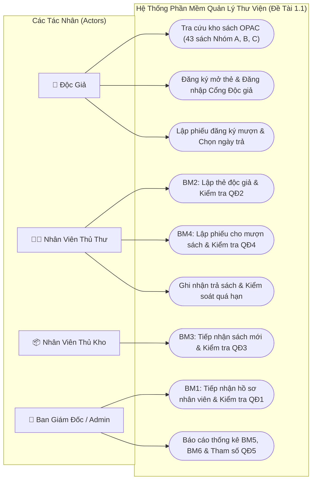
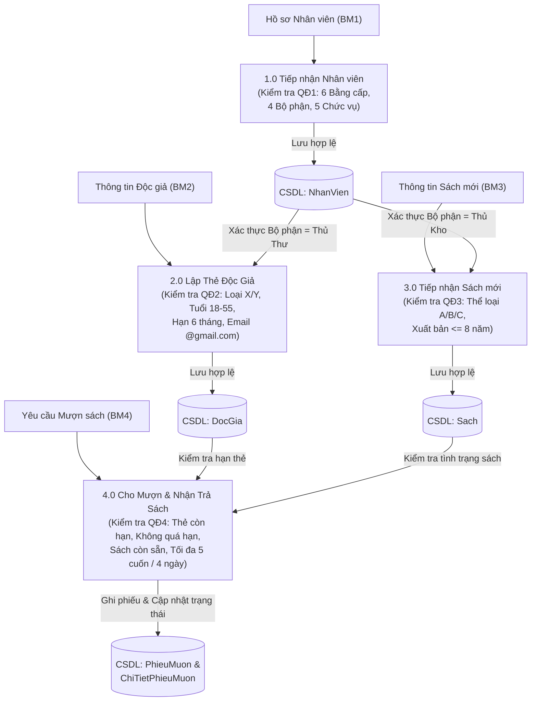
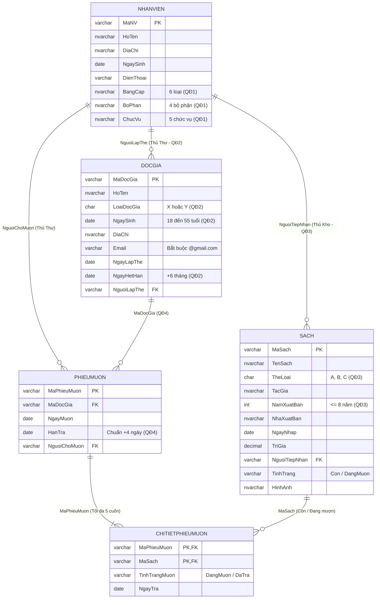
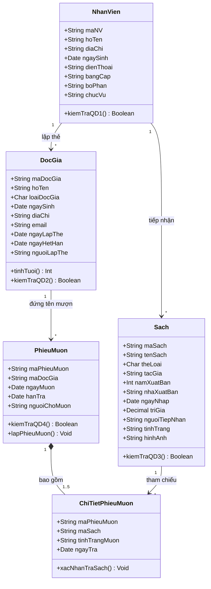
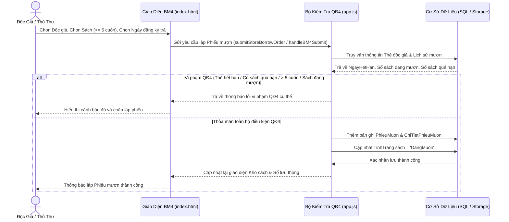
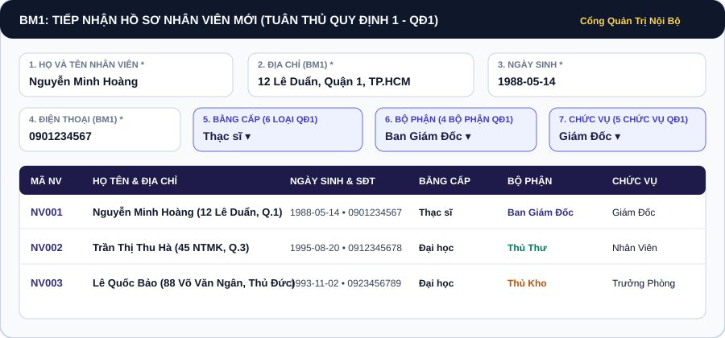
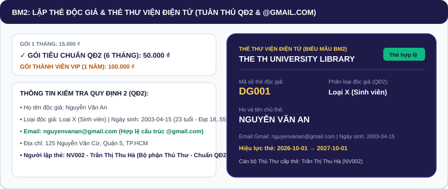
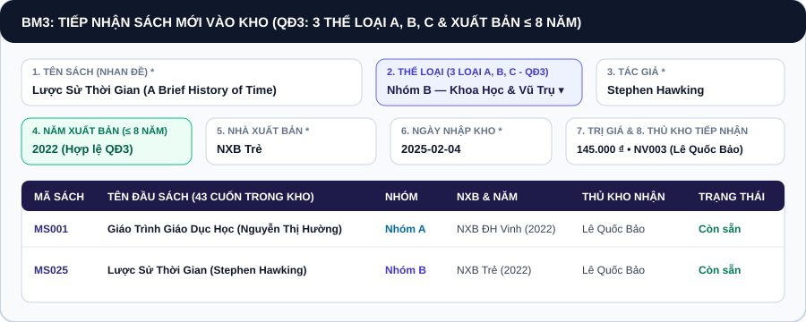
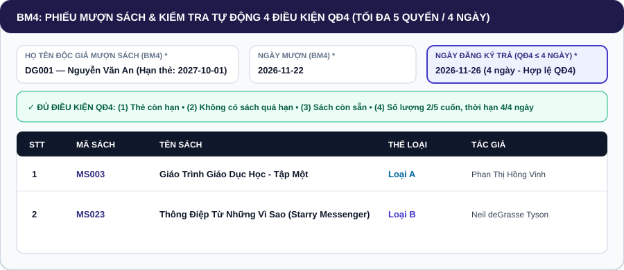
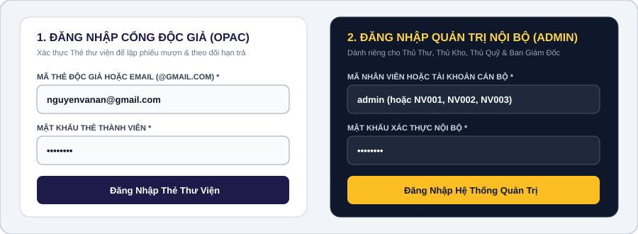

# QUYỂN BÁO CÁO BÀI TẬP LỚN – HỌC PHẦN CÔNG NGHỆ PHẦN MỀM
## ĐỀ TÀI 1.1: THIẾT KẾ PHẦN MỀM QUẢN LÝ THƯ VIỆN

- **Học phần:** Công Nghệ Phần Mềm (Software Engineering)
- **Mã đề tài:** 1.1 — Đề tài Quản Lý Thư Viện
- **Sinh viên thực hiện:**
  1. **Nguyễn Thanh Hiền**
  2. **Nguyễn Trương Hà Mi**
- **Quy định đặt tên file nộp:** `NguyenThanhHien+NguyenTruongHaMi.rar`
- **Link mở trực tiếp phần mềm:** [index.html](./index.html)
- **Link mở bản Báo cáo trực quan (In/Xuất PDF):** [QUYEN_BAO_CAO_TIEU_LUAN_CNPM.html](./QUYEN_BAO_CAO_TIEU_LUAN_CNPM.html)
- **Tập tin Cơ sở dữ liệu SQL Server:** [database/schema.sql](./database/schema.sql)
- **Tập tin Mã nguồn xử lý nghiệp vụ:** [app.js](./app.js), [books-data.js](./books-data.js) & [server.js](./server.js)

---

# A. PHẦN MỞ ĐẦU

## 1. Lý do chọn đề tài
Trong bối cảnh chuyển đổi số giáo dục đại học và hiện đại hóa các trung tâm học liệu hiện nay, thư viện đóng vai trò là trung tâm lưu trữ và cung cấp tri thức cho sinh viên, giảng viên và cán bộ nghiên cứu. Tuy nhiên, tại nhiều đơn vị, quy trình quản lý hồ sơ nhân sự, cấp thẻ độc giả, biên mục sách mới và theo dõi lưu thông mượn – trả sách vẫn còn thực hiện thủ công trên sổ sách hoặc các bảng tính rời rạc. Phương thức truyền thống này bộc lộ nhiều hạn chế lớn:
- **Sai sót trong kiểm tra quy định nghiệp vụ:** Dễ xảy ra nhầm lẫn khi kiểm tra độ tuổi độc giả (`18–55 tuổi`), thời hạn hiệu lực thẻ (`6 tháng`), năm xuất bản sách (`trong vòng 8 năm`), thẩm quyền từng bộ phận (`Thủ Thư`, `Thủ Kho`), hoặc cho mượn vượt quá số lượng quy định (`tối đa 5 quyển trong 4 ngày`) và bỏ sót các độc giả đang giữ sách quá hạn.
- **Tốn thời gian tra cứu:** Độc giả khó nắm bắt được cuốn sách mình cần thuộc thể loại nào (`A`, `B`, hay `C`), có hình ảnh bìa và thông tin xuất bản ra sao, hiện còn sẵn trên kệ hay đang có người khác mượn.
- **Thiếu tính liên kết và thống kê tức thời:** Bộ phận Thủ Thư, Thủ Kho và Ban Giám Đốc khó tổng hợp số liệu báo cáo lưu thông theo thời gian thực.

Xuất phát từ nhu cầu thực tiễn đó và bám sát yêu cầu của **Đề tài 1.1: Quản Lý Thư Viện** thuộc học phần **Công Nghệ Phần Mềm**, nhóm chúng em (**Nguyễn Thanh Hiền** và **Nguyễn Trương Hà Mi**) lựa chọn đề tài **"Thiết kế và xây dựng Phần mềm Quản Lý Thư Viện (The TH Library)"** nhằm áp dụng toàn diện quy trình phân tích, thiết kế hệ thống, thiết kế hướng đối tượng và lập trình cơ sở dữ liệu vào một sản phẩm phần mềm hoàn chỉnh, trực quan và chạy thực tế.

---

## 2. Phạm vi nghiên cứu
Phạm vi nghiên cứu và triển khai của đề tài tập trung giải quyết trọn vẹn bài toán nghiệp vụ **Đề tài 1.1 Quản Lý Thư Viện** (trang 1–2 tài liệu đề cương Bài tập lớn CNPM), bao gồm:

### 2.1. Phạm vi nghiệp vụ cốt lõi (Mục 1.1.1 & 1.1.2)
1. **Tiếp nhận nhân viên (`BM1` – `QĐ1`):**
   - Quản lý hồ sơ nhân viên gồm 7 trường thông tin chuẩn: *Họ và tên, Địa chỉ, Ngày sinh, Điện thoại, Bằng cấp, Bộ phận, Chức vụ*.
   - Kiểm soát chặt chẽ **QĐ1**: 6 trình độ bằng cấp (*Tú tài, Trung cấp, Cao đẳng, Đại học, Thạc sĩ, Tiến sĩ*), 4 bộ phận (*Thủ Thư, Thủ Kho, Thủ Quỹ, Ban Giám Đốc*), và 5 chức vụ (*Giám Đốc, Phó Giám Đốc, Trưởng Phòng, Phó Phòng, Nhân Viên*).
2. **Lập thẻ độc giả (`BM2` – `QĐ2`):**
   - Quản lý thông tin thẻ độc giả gồm 7 trường chuẩn: *Họ và tên, Loại độc giả, Ngày sinh, Địa chỉ, Email (`@gmail.com`), Ngày lập thẻ, Người lập*.
   - Kiểm soát tự động **QĐ2**: 2 loại độc giả (*Loại X – Sinh viên, Loại Y – Giảng viên/Cán bộ*), độ tuổi từ **18 đến 55 tuổi**, thời hạn thẻ có giá trị **6 tháng** (mở rộng hỗ trợ biểu phí rõ ràng: Gói 1 tháng `15.000 ₫`, Gói tiêu chuẩn QĐ2 6 tháng `50.000 ₫`, Gói VIP 1 năm `100.000 ₫`), và người lập thẻ bắt buộc là nhân viên thuộc bộ phận **Thủ Thư**.
3. **Tiếp nhận sách mới (`BM3` – `QĐ3`):**
   - Quản lý danh mục sách gồm 8 trường chuẩn: *Tên sách, Thể loại, Tác giả, Năm xuất bản, Nhà xuất bản, Ngày nhập, Trị giá, Người tiếp nhận* kèm *Hình ảnh bìa sách*.
   - Kiểm soát tự động **QĐ3**: 3 thể loại (*Nhóm A: Giáo dục, Tâm lý & Lịch sử; Nhóm B: Khoa học, Vũ trụ & Tự nhiên; Nhóm C: Kinh tế, Thương hiệu & Văn học*), chỉ tiếp nhận sách xuất bản **trong vòng 8 năm**, và người tiếp nhận bắt buộc thuộc bộ phận **Thủ Kho**. Hệ thống đã biên mục sẵn **43 đầu sách thực tế** kèm hình ảnh bìa chính xác.
4. **Cho mượn sách & Quản lý trả sách (`BM4` – `QĐ4`):**
   - Lập phiếu mượn sách gồm: *Họ tên độc giả, Ngày mượn, Ngày đăng ký trả*, và bảng chi tiết 5 cột chuẩn (*STT, Mã Sách, Tên Sách, Thể Loại, Tác Giả*).
   - Kiểm soát tự động **QĐ4**: Chỉ cho mượn khi **(1) Thẻ còn hạn**, **(2) Độc giả không có sách mượn quá hạn**, **(3) Sách không có người đang mượn**, **(4) Mỗi độc giả mượn tối đa 5 quyển sách trong 4 ngày**.

### 2.2. Phạm vi kiến trúc phần mềm
- Xây dựng hệ thống gồm **2 phân hệ liên kết đồng bộ thời gian thực**:
  1. **Cổng Thông Tin Độc Giả & Tra Cứu OPAC (Bên ngoài):** Giúp độc giả tra cứu 43 đầu sách theo chuyên mục A/B/C, đăng ký mở thẻ thành viên, đăng nhập tài khoản cá nhân để đăng ký mượn sách, chọn ngày trả và theo dõi hạn trả.
  2. **Cổng Cán Bộ Quản Trị Nội Bộ (Admin Portal):** Ẩn sau màn hình xác thực cán bộ riêng biệt, phục vụ nhân viên thư viện thực hiện các biểu mẫu `BM1`, `BM2`, `BM3`, `BM4`, nhận trả sách, xem báo cáo thống kê (`BM5`, `BM6`) và cấu hình tham số quy định (`QĐ5`).

---

## 3. Phương pháp nghiên cứu
1. **Phương pháp nghiên cứu tài liệu và khảo sát yêu cầu:** Phân tích đặc tả yêu cầu Đề tài 1.1 (`BM1` → `BM4` và `QĐ1` → `QĐ4`), khảo sát quy trình nghiệp vụ thư viện đại học thực tế.
2. **Phương pháp Phân tích Thiết kế Hệ thống hướng cấu trúc (PTTKHT):** Phân rã chức năng hệ thống, xây dựng biểu đồ luồng dữ liệu (DFD) mức ngữ cảnh và mức đỉnh, thiết kế mô hình thực thể kết hợp (ERD) và chuẩn hóa cơ sở dữ liệu quan hệ đạt chuẩn 3NF.
3. **Phương pháp Phân tích Thiết kế Hướng đối tượng (PTTKĐT - UML):** Xây dựng biểu đồ Use Case, biểu đồ Lớp (Class Diagram), biểu đồ Tuần tự (Sequence Diagram) và biểu đồ Hoạt động (Activity Diagram).
4. **Phương pháp Thực nghiệm & Kiểm thử phần mềm:** Lập trình cơ sở dữ liệu trên **SQL Server** (sử dụng `PRIMARY KEY`, `FOREIGN KEY`, `CHECK CONSTRAINT`, và `TRIGGER`), xây dựng giao diện Web (HTML5, TailwindCSS, JavaScript ES6, Node.js), và kiểm thử toàn bộ các ràng buộc `QĐ1` → `QĐ4`.

---

# B. NỘI DUNG

## I. CƠ SỞ LÝ THUYẾT

### 1. Phân tích thiết kế hệ thống (PTTKHT)
**Phân tích và thiết kế hệ thống thông tin (System Analysis and Design)** là phương pháp tiếp cận có cấu trúc nhằm xác định rõ **Hệ thống làm gì (What)** và **Làm như thế nào (How)**. Trong đề tài Quản lý thư viện, PTTKHT được thực hiện qua các bước:

#### 1.1. Phân rã chức năng nghiệp vụ
Hệ thống được phân rã thành 4 phân hệ nghiệp vụ gắn liền với 4 bộ phận trong `QĐ1`:
- **Phân hệ Quản trị Nhân sự (`BM1` – `QĐ1`):** Tiếp nhận nhân viên mới, kiểm tra 6 loại bằng cấp, phân bổ vào 4 bộ phận (*Thủ Thư, Thủ Kho, Thủ Quỹ, Ban Giám Đốc*) và 5 chức vụ.
- **Phân hệ Quản lý Thẻ Độc giả (`BM2` – `QĐ2`):** Do bộ phận **Thủ Thư** phụ trách, kiểm tra loại độc giả (`X`, `Y`), kiểm tra tuổi `18–55`, kiểm tra định dạng `@gmail.com` và cấp thẻ có giá trị `6 tháng`.
- **Phân hệ Quản lý Kho sách (`BM3` – `QĐ3`):** Do bộ phận **Thủ Kho** phụ trách, phân loại sách vào 3 nhóm (`A`, `B`, `C`), kiểm tra điều kiện năm xuất bản `trong vòng 8 năm` và cập nhật trạng thái tồn kho (`Con` / `DangMuon`).
- **Phân hệ Quản lý Lưu thông Mượn – Trả (`BM4` – `QĐ4`):** Do bộ phận **Thủ Thư** phụ trách, kiểm tra đồng thời 4 điều kiện `QĐ4` trước khi ghi nhận phiếu mượn (tối đa 5 quyển / 4 ngày) và tự động giải phóng trạng thái sách khi độc giả hoàn trả.

#### 1.2. Thiết kế Cơ sở dữ liệu mức Logic (Đạt chuẩn 3NF)
Hệ thống CSDL gồm 6 bảng quan hệ chặt chẽ:
1. `ThamSo(TenThamSo [PK], GiaTri, MoTa)`
2. `NhanVien(MaNV [PK], HoTen, DiaChi, NgaySinh, DienThoai, BangCap, BoPhan, ChucVu, TaiKhoan, MatKhau)`
3. `DocGia(MaDocGia [PK], HoTen, LoaiDocGia, NgaySinh, DiaChi, Email, MatKhau, GoiDangKy, TenGoi, PhiDangKy, NgayLapThe, NgayHetHan, NguoiLapThe [FK -> NhanVien])`
4. `Sach(MaSach [PK], TenSach, TheLoai, ChuyenMuc, TacGia, NamXuatBan, NhaXuatBan, NgayNhap, TriGia, NguoiTiepNhan [FK -> NhanVien], TinhTrang, HinhAnh)`
5. `PhieuMuon(MaPhieuMuon [PK], MaDocGia [FK -> DocGia], NgayMuon, HanTra, NguoiChoMuon [FK -> NhanVien], GhiChu)`
6. `ChiTietPhieuMuon(MaPhieuMuon [PK, FK], MaSach [PK, FK], TinhTrangMuon, NgayTra)`

---

### 2. Phân tích thiết kế hướng đối tượng (PTTKĐT)
**Phân tích thiết kế hướng đối tượng (OOAD)** mô hình hóa hệ thống thông qua các đối tượng thực thể (Entity Objects), đối tượng biên (Boundary/UI Objects) và đối tượng điều khiển (Control Objects) theo mô hình kiến trúc **MVC / 3-Layer**:
- **Tầng Giao diện (Boundary / View - `index.html`):** Chia thành 2 không gian rõ ràng là *Cổng Độc giả OPAC* (`#portal-public`) và *Cổng Cán bộ Quản trị* (`#portal-admin-workspace`).
- **Tầng Điều khiển & Nghiệp vụ (Controller / Business Logic - `app.js`):** Đóng gói các phương thức kiểm tra quy định (`calculateAge()`, `isValidGmail()`, `getReaderBorrowStatus()`, `handleBM1Submit()`, `handleBM2Submit()`, `handleBM3Submit()`, `handleBM4Submit()`, `submitStoreBorrowOrder()`).
- **Tầng Dữ liệu (Entity / Data Access - `database/schema.sql` & `books-data.js`):** Đảm bảo tính toàn vẹn dữ liệu ở cả mức CSDL SQL Server (thông qua `CHECK` và `TRIGGER`) lẫn mức bộ nhớ ứng dụng.

---

### 3. Các mô hình hệ thống

#### 3.1. Mô hình Use Case tổng quát (Use Case Diagram)


#### 3.2. Mô hình Luồng dữ liệu DFD (Data Flow Diagram)


#### 3.3. Mô hình Thực thể Kết hợp (ERD)


#### 3.4. Biểu đồ Lớp (Class Diagram)


#### 3.5. Biểu đồ Tuần tự (Sequence Diagram) — Nghiệp vụ Cho mượn sách (`BM4` – `QĐ4`)


---

## II. THỰC HÀNH

### 1. Mô tả rõ phần mềm đã làm được những gì
Phần mềm **Hệ thống Quản lý Thư viện Số (The TH Library)** đã hoàn thiện trọn vẹn toàn bộ yêu cầu của **Đề tài 1.1** và mở rộng theo mô hình thư viện điện tử thực tế:
1. **Thực hiện đầy đủ 4 Biểu mẫu (`BM1`, `BM2`, `BM3`, `BM4`) và kiểm soát tự động 4 Quy định (`QĐ1`, `QĐ2`, `QĐ3`, `QĐ4`):**
   - **BM1 – QĐ1:** Tiếp nhận hồ sơ nhân viên với đủ 7 trường (*Họ tên, Địa chỉ, Ngày sinh, Điện thoại, Bằng cấp, Bộ phận, Chức vụ*), ràng buộc đúng 6 bằng cấp, 4 bộ phận, 5 chức vụ.
   - **BM2 – QĐ2:** Lập thẻ độc giả (*Loại X, Loại Y*), kiểm tra tuổi từ **18 đến 55**, kiểm tra cấu trúc Email bắt buộc **`@gmail.com`**, tự động tính hạn thẻ (**6 tháng** chuẩn QĐ2 hoặc theo gói 1 tháng `15.000 ₫`, 6 tháng `50.000 ₫`, 1 năm `100.000 ₫`), phân quyền đúng nhân viên **Thủ Thư** lập thẻ.
   - **BM3 – QĐ3:** Đã phân loại, đặt tên chính xác và nạp hình ảnh bìa cho **43 đầu sách** thuộc 3 nhóm (**Nhóm A: 14 cuốn**, **Nhóm B: 14 cuốn**, **Nhóm C: 15 cuốn**). Kiểm tra tự động năm xuất bản **trong vòng 8 năm** và phân quyền nhân viên **Thủ Kho** tiếp nhận.
   - **BM4 – QĐ4:** Lập phiếu mượn sách hiển thị đúng bảng 5 cột (*STT, Mã Sách, Tên Sách, Thể Loại, Tác Giả*), cho phép chọn **Ngày đăng ký trả sách**, kiểm tra tự động 4 điều kiện QĐ4 (*Thẻ còn hạn, Không có sách quá hạn, Sách còn sẵn, Tối đa 5 quyển trong 4 ngày*).
2. **Kiến trúc 2 Cổng giao diện tách biệt & đồng bộ thời gian thực:**
   - **Cổng Độc giả & Tra cứu OPAC bên ngoài:** Hiển thị kệ sách 43 cuốn, lọc theo nhóm A/B/C, đăng ký thẻ thành viên, đăng nhập độc giả để lập phiếu mượn và xem Thẻ thư viện điện tử.
   - **Cổng Cán bộ Quản trị Nội bộ (Admin Portal):** Có màn hình đăng nhập cán bộ riêng biệt, quản lý toàn bộ `BM1` → `BM6` và thay đổi quy định `QĐ5`.

---

### 2. Hướng dẫn sử dụng phần mềm tạo ra
- **Cách mở phần mềm:**
  - **Cách 1 (Mở trực tiếp):** Nhấp đúp vào file **[index.html](./index.html)**.
  - **Cách 2 (Chạy dạng cửa sổ phần mềm Desktop):** Nhấp đúp vào file **[CHAY_PHAN_MEM_DESKTOP.bat](./CHAY_PHAN_MEM_DESKTOP.bat)**.
  - **Cách 3 (Chạy qua Web Server Node.js):** Chạy **[CHAY_SERVER_NODEJS.bat](./CHAY_SERVER_NODEJS.bat)** hoặc gõ lệnh `npm start` để mở tại `http://localhost:3000`.
- **Thao tác dành cho Độc giả (Bên ngoài):**
  1. Vào mục **Tra Cứu Kho Sách** để lọc xem 43 đầu sách theo Nhóm A, Nhóm B, Nhóm C.
  2. Vào mục **Cấp Thẻ Thành Viên** để chọn gói thẻ (`15.000 ₫/tháng`, `50.000 ₫/6 tháng`, `100.000 ₫/năm`), điền thông tin (tuổi 18–55, email `@gmail.com`) để nhận Mã thẻ mới.
  3. Nhấn **Đăng nhập Độc giả** (nhập mã thẻ vừa tạo hoặc tài khoản mẫu `DG001` / mật khẩu `123456`) $\rightarrow$ Chọn tối đa 5 cuốn sách $\rightarrow$ Mở **Phiếu mượn** $\rightarrow$ Chọn **Ngày đăng ký trả** $\rightarrow$ Nhấn **Xác Nhận Lập Phiếu Mượn Sách**.
- **Thao tác dành cho Cán bộ Thư viện (Bên trong Cổng Cán Bộ Quản Trị):**
  1. Nhấn nút **"Cổng Cán Bộ Quản Trị"** ở góc trên bên phải.
  2. Đăng nhập bằng tài khoản Ban Giám Đốc (`admin` / `admin123`), Thủ Thư (`NV002` / `123456`) hoặc Thủ Kho (`NV003` / `123456`).
  3. Chọn từng phân hệ trên thanh menu bên trái để thực hiện `BM1`, `BM2`, `BM3`, `BM4`, nhận trả sách và xem báo cáo `BM5`, `BM6`.

---

### 3. Mô tả chi tiết từng Hình ảnh tương quan với Code (`Hình ảnh <-- Code SQL, HTML & JavaScript tạo ra ảnh đó`)

Dưới đây là phần đối chiếu chi tiết **8 Hình ảnh thực tế từ phần mềm** kèm **đoạn code SQL Server, HTML5 và JavaScript** tương ứng đã trực tiếp tạo ra hình ảnh và chức năng đó:

---

#### 3.1. Hình ảnh 1: Hình ảnh Bìa sách & Thẻ sách Nhóm A (Giáo dục, Tâm lý học & Lịch sử — 14 đầu sách) $\longleftarrow$ Code tạo ra Hình ảnh 1

- **Hiển thị trực tiếp hình ảnh các đầu sách Nhóm A từ phần mềm:**

|  |  |  |  |
| :-: | :-: | :-: | :-: |
| **MS001 — Nhóm A**<br/>*Giáo Trình Giáo Dục Học*<br/>Nguyễn Thị Hường (85.000 ₫) | **MS004 — Nhóm A**<br/>*Giáo Dục Vì Cuộc Sống Sáng Tạo*<br/>T. Makiguchi (125.000 ₫) | **MS005 — Nhóm A**<br/>*Tâm Lý Học Toàn Thư*<br/>Nhiều Tác Giả (145.000 ₫) | **MS008 — Nhóm A**<br/>*Thách Thức Sáng Tạo*<br/>C. Christensen (165.000 ₫) |

- **Code 1 (SQL Server - [database/schema.sql](./database/schema.sql)) tạo bảng `Sach` và nạp dữ liệu Nhóm A:**
```sql
CREATE TABLE Sach (
    MaSach VARCHAR(20) PRIMARY KEY,
    TenSach NVARCHAR(250) NOT NULL,
    TheLoai CHAR(1) NOT NULL CHECK (TheLoai IN ('A', 'B', 'C')),
    ChuyenMuc NVARCHAR(100),
    TacGia NVARCHAR(150) NOT NULL,
    NamXuatBan INT NOT NULL,
    NhaXuatBan NVARCHAR(150) NOT NULL,
    NgayNhap DATE NOT NULL,
    TriGia DECIMAL(18,0) NOT NULL CHECK (TriGia >= 0),
    NguoiTiepNhan VARCHAR(20) NOT NULL REFERENCES NhanVien(MaNV),
    TinhTrang VARCHAR(20) NOT NULL DEFAULT 'Con' CHECK (TinhTrang IN ('Con', 'DangMuon')),
    HinhAnh NVARCHAR(500)
);

INSERT INTO Sach (MaSach, TenSach, TheLoai, ChuyenMuc, TacGia, NamXuatBan, NhaXuatBan, NgayNhap, TriGia, NguoiTiepNhan, TinhTrang, HinhAnh) VALUES
('MS001', N'Giáo Trình Giáo Dục Học', 'A', N'Giáo Dục & Sư Phạm', N'Nguyễn Thị Hường (Chủ biên)', 2022, N'NXB Đại Học Vinh', '2025-01-10', 85000, 'NV003', 'Con', 'images/nhom A/1794538676885_112601018615683622_3100374492545443504_b491343d78e50d1b905aada8e28e5f39.jpg'),
('MS004', N'Giáo Dục Vì Cuộc Sống Sáng Tạo', 'A', N'Triết Lý Giáo Dục', N'Tsunesaburo Makiguchi', 2021, N'NXB Trẻ', '2025-01-12', 125000, 'NV003', 'Con', 'images/nhom A/1794538676955_112601018615683622_3100374492545443504_8cc451d98c7ce5d5dc48180ffd3ff082.jpg');
```

- **Code 2 (JavaScript - [books-data.js](./books-data.js) & [app.js](./app.js)) dựng thẻ hình ảnh bìa sách Nhóm A lên giao diện:**
```javascript
function createBookCardHTML(book) {
  const isAvail = book.tinhTrang === 'Con';
  const badgeClass = getCategoryBadgeClass(book.theLoai); // Nhóm A -> bg-sky-700 text-white
  return `
    <div class="bg-white rounded-2xl border border-slate-200/90 overflow-hidden shadow-xs hover:shadow-xl transition-all duration-300 flex flex-col group">
      <div class="relative aspect-[3/4] bg-slate-100 overflow-hidden cursor-pointer" onclick="openBookDetailModal('${book.maSach}')">
        
        <div class="absolute top-2.5 left-2.5 flex flex-col gap-1">
          <span class="px-2.5 py-0.5 rounded-md text-[11px] font-bold shadow ${badgeClass}">Nhóm ${book.theLoai}</span>
          <span class="px-2 py-0.5 rounded text-[10px] font-mono font-bold bg-slate-900/80 text-white">${book.maSach}</span>
        </div>
      </div>
      <div class="p-4">
        <h3 class="font-bold text-slate-900 text-sm line-clamp-2">${book.tenSach}</h3>
        <p class="text-xs text-slate-600 mt-1.5">${book.tacGia}</p>
        <span class="font-extrabold text-slate-900">${formatVND(book.triGia)}</span>
      </div>
    </div>`;
}
```

---

#### 3.2. Hình ảnh 2: Hình ảnh Bìa sách & Thẻ sách Nhóm B (Khoa học, Vũ trụ & Lược sử Nhân loại — 14 đầu sách) $\longleftarrow$ Code tạo ra Hình ảnh 2

- **Hiển thị trực tiếp hình ảnh các đầu sách Nhóm B từ phần mềm:**

|  |  |  |  |
| :-: | :-: | :-: | :-: |
| **MS015 — Nhóm B**<br/>*Giai Điệu Bí Ẩn*<br/>Trịnh Xuân Thuận (175.000 ₫) | **MS025 — Nhóm B**<br/>*Lược Sử Thời Gian*<br/>Stephen Hawking (145.000 ₫) | **MS026 — Nhóm B**<br/>*Khai Sáng Thời Hiện Đại*<br/>Steven Pinker (249.000 ₫) | **MS027 — Nhóm B**<br/>*Sapiens: Lược Sử Loài Người*<br/>Yuval Noah Harari (215.000 ₫) |

- **Code tạo ra và lọc hiển thị các đầu sách Nhóm B ([books-data.js](./books-data.js) & [app.js](./app.js)):**
```javascript
// Dữ liệu sách Nhóm B trong books-data.js:
{
  maSach: 'MS025',
  tenSach: 'Lược Sử Thời Gian (A Brief History of Time)',
  theLoai: 'B',
  chuyenMuc: 'Vật Lý Vũ Trụ',
  tacGia: 'Stephen Hawking',
  namXuatBan: 2022,
  nhaXuatBan: 'NXB Trẻ',
  ngayNhap: '2025-02-04',
  triGia: 145000,
  nguoiTiepNhan: 'NV003',
  tinhTrang: 'Con',
  hinhAnh: 'images/nhom B/1794538814317_112601018615683622_3100374492545443504_d39bc6c551cf5e16cf35c665eab5ac6c.jpg'
}

// Hàm lọc sách theo Nhóm B (theLoai === 'B') trong app.js:
function filterStoreByCategory(cat) {
  selectedCategory = cat; // 'B'
  renderCatalogPage();
}
```

---

#### 3.3. Hình ảnh 3: Hình ảnh Bìa sách & Thẻ sách Nhóm C (Kinh tế, Thương hiệu & Văn học — 15 đầu sách) $\longleftarrow$ Code tạo ra Hình ảnh 3

- **Hiển thị trực tiếp hình ảnh các đầu sách Nhóm C từ phần mềm:**

|  |  |  |  |
| :-: | :-: | :-: | :-: |
| **MS029 — Nhóm C**<br/>*Kinh Tế Học Thời Khó Nhọc*<br/>A. Banerjee & E. Duflo (190.000 ₫) | **MS031 — Nhóm C**<br/>*How Brands Grow*<br/>J. Romaniuk & B. Sharp (179.000 ₫) | **MS035 — Nhóm C**<br/>*Xuân Tình*<br/>Ernest Hemingway (98.000 ₫) | **MS043 — Nhóm C**<br/>*Chúng Ta Sống Để Bước Tiếp*<br/>Nguyễn Phong Việt (110.000 ₫) |

- **Code tạo ra các đầu sách Nhóm C ([books-data.js](./books-data.js)):**
```javascript
{
  maSach: 'MS029',
  tenSach: 'Kinh Tế Học Thời Khó Nhọc (Good Economics for Hard Times)',
  theLoai: 'C',
  chuyenMuc: 'Kinh Tế Học',
  tacGia: 'Abhijit V. Banerjee & Esther Duflo',
  namXuatBan: 2022,
  nhaXuatBan: 'NXB Trẻ',
  ngayNhap: '2025-02-08',
  triGia: 190000,
  nguoiTiepNhan: 'NV003',
  tinhTrang: 'Con',
  hinhAnh: 'images/nhom C/1794538866201_112601018615683622_3100374492545443504_cc6214880c9a1704dbb82a7046d1be02.jpg'
}
```

---

#### 3.4. Hình ảnh 4: Giao diện Biểu mẫu `BM1` (Hồ Sơ Nhân Viên) & Kiểm tra `QĐ1` $\longleftarrow$ Code SQL, HTML & JavaScript tạo ra Hình ảnh 4
- **Hình ảnh giao diện Biểu mẫu `BM1` trên phần mềm:**



- **Mô tả giao diện `BM1`:** Hiển thị form gồm đúng 7 ô nhập liệu chuẩn trang 3 PDF (*Họ và tên, Địa chỉ, Ngày sinh, Điện thoại, Bằng cấp, Bộ phận, Chức vụ*) và bảng danh sách nhân sự bên dưới.
- **Code SQL tạo bảng `NhanVien` & Ràng buộc `QĐ1` ([database/schema.sql](./database/schema.sql)):**
```sql
CREATE TABLE NhanVien (
    MaNV VARCHAR(20) PRIMARY KEY,
    HoTen NVARCHAR(100) NOT NULL,
    DiaChi NVARCHAR(255) NOT NULL,
    NgaySinh DATE NOT NULL,
    DienThoai VARCHAR(20) NOT NULL,
    BangCap NVARCHAR(50) NOT NULL CHECK (BangCap IN (N'Tú tài', N'Trung cấp', N'Cao đẳng', N'Đại học', N'Thạc sĩ', N'Tiến sĩ')),
    BoPhan NVARCHAR(50) NOT NULL CHECK (BoPhan IN (N'Thủ Thư', N'Thủ Kho', N'Thủ Quỹ', N'Ban Giám Đốc')),
    ChucVu NVARCHAR(50) NOT NULL CHECK (ChucVu IN (N'Giám Đốc', N'Phó Giám Đốc', N'Trưởng Phòng', N'Phó Phòng', N'Nhân Viên'))
);
```
- **Code HTML5 tạo giao diện Form `BM1` ([index.html](./index.html)):**
```html
<form onsubmit="handleBM1Submit(event)" class="grid grid-cols-1 sm:grid-cols-3 gap-4 text-sm">
  <input id="bm1-name" required placeholder="Nhập họ và tên" />
  <input id="bm1-address" required placeholder="Số nhà, đường, quận/huyện..." />
  <input id="bm1-dob" type="date" required />
  <input id="bm1-phone" required placeholder="0901234567" />
  <select id="bm1-degree">
    <option>Tú tài</option><option>Trung cấp</option><option>Cao đẳng</option>
    <option selected>Đại học</option><option>Thạc sĩ</option><option>Tiến sĩ</option>
  </select>
  <select id="bm1-dept">
    <option>Thủ Thư</option><option>Thủ Kho</option><option>Thủ Quỹ</option><option>Ban Giám Đốc</option>
  </select>
  <select id="bm1-role">
    <option>Nhân Viên</option><option>Phó Phòng</option><option>Trưởng Phòng</option>
    <option>Phó Giám Đốc</option><option>Giám Đốc</option>
  </select>
</form>
```

---

#### 3.5. Hình ảnh 5: Giao diện Biểu mẫu `BM2` (Đăng ký Thẻ Độc Giả 3 Gói Cước & Thẻ Thư Viện Điện Tử) $\longleftarrow$ Code SQL, HTML & JavaScript tạo ra Hình ảnh 5
- **Hình ảnh giao diện Biểu mẫu `BM2` & Thẻ Thư Viện Điện Tử trên phần mềm:**



- **Mô tả giao diện `BM2`:** Hiển thị 3 thẻ chọn gói thành viên (*Gói 1 Tháng 15.000 ₫*, *Gói Tiêu Chuẩn QĐ2 6 Tháng 50.000 ₫*, *Gói VIP 1 Năm 100.000 ₫*), form nhập thông tin độc giả có kiểm tra lỗi đỏ khi nhập sai `@gmail.com` hoặc tuổi ngoài `18–55`, và hình ảnh **Thẻ Thư Viện Điện Tử** sau khi cấp thẻ.
- **Code SQL Trigger kiểm tra `QĐ2` ([database/schema.sql](./database/schema.sql)):**
```sql
CREATE TRIGGER TRG_Check_QD2_DocGia
ON DocGia AFTER INSERT, UPDATE AS
BEGIN
    IF EXISTS (SELECT 1 FROM inserted WHERE (YEAR(GETDATE()) - YEAR(NgaySinh)) < 18 OR (YEAR(GETDATE()) - YEAR(NgaySinh)) > 55)
    BEGIN
        RAISERROR(N'Vi phạm QĐ2: Tuổi độc giả phải từ 18 đến 55 tuổi!', 16, 1);
        ROLLBACK TRANSACTION; RETURN;
    END
    IF EXISTS (SELECT 1 FROM inserted i JOIN NhanVien nv ON i.NguoiLapThe = nv.MaNV WHERE nv.BoPhan <> N'Thủ Thư')
    BEGIN
        RAISERROR(N'Vi phạm QĐ2: Người lập thẻ độc giả phải là nhân viên thuộc bộ phận Thủ Thư!', 16, 1);
        ROLLBACK TRANSACTION; RETURN;
    END
END;
```
- **Code JavaScript vẽ chiếc Thẻ Thư Viện Điện Tử (`BM2`) ([app.js](./app.js)):**
```javascript
<div class="rounded-2xl p-6 text-white bg-gradient-to-br from-slate-900 via-indigo-950 to-slate-900 border border-slate-800 shadow-xl">
  <div class="text-[10px] uppercase tracking-widest text-amber-300 font-bold">THẺ THƯ VIỆN ĐIỆN TỬ (BM2)</div>
  <span class="text-lg font-mono font-black text-amber-300">${currentReader.maDocGia}</span>
  <span class="text-base font-extrabold uppercase">${currentReader.hoTen}</span>
  <span class="font-bold text-amber-300">${currentReader.tenGoi} (${currentReader.ngayLapThe} → ${currentReader.ngayHetHan})</span>
</div>
```

---

#### 3.6. Hình ảnh 6: Giao diện Biểu mẫu `BM3` (Tiếp Nhận Sách Mới Vào Kho) & Kiểm tra `QĐ3` $\longleftarrow$ Code SQL & JavaScript tạo ra Hình ảnh 6
- **Hình ảnh giao diện Biểu mẫu `BM3` trên phần mềm:**



- **Mô tả giao diện `BM3`:** Form nhập 8 thông tin sách mới (*Nhan đề, Phân loại A/B/C, Tác giả, Năm xuất bản ≤ 8 năm, Nhà xuất bản, Trị giá, Ngày nhập, Thủ Kho tiếp nhận, Đường dẫn ảnh bìa*).
- **Code SQL Trigger kiểm tra `QĐ3` ([database/schema.sql](./database/schema.sql)) & JavaScript ([app.js](./app.js)):**
```javascript
// Lọc chỉ nhân viên bộ phận Thủ Kho được đứng tên tiếp nhận sách (QĐ3):
const thuKhoList = db.nhanVien.filter(n => n.boPhan === 'Thủ Kho');
staffSelect.innerHTML = thuKhoList.map(n => `<option value="${n.maNV}">${n.maNV} — ${n.hoTen}</option>`).join('');

// Kiểm tra năm xuất bản không lớn hơn năm hiện tại và trong vòng 8 năm (QĐ3):
const currentYear = new Date().getFullYear();
if (namXuatBan > currentYear || currentYear - namXuatBan > db.thamSo.KhoangCachNamXB) {
  showToast(`Vi phạm QĐ3: Chỉ nhận sách xuất bản trong vòng ${db.thamSo.KhoangCachNamXB} năm trở lại đây.`, 'error');
  return;
}
```

---

#### 3.7. Hình ảnh 7: Giao diện Biểu mẫu `BM4` (Phiếu Mượn Sách 5 cột chuẩn & Chọn Ngày đăng ký trả) $\longleftarrow$ Code SQL, HTML & JavaScript tạo ra Hình ảnh 7
- **Hình ảnh giao diện Biểu mẫu `BM4` trên phần mềm:**



- **Mô tả giao diện `BM4`:** Hiển thị form chọn Độc giả, Ngày mượn, **Ngày đăng ký trả** (tối đa `+4 ngày` theo `QĐ4`), danh sách chọn tối đa 5 cuốn sách đang Còn sẵn, và tự động dựng **Bảng Chi Tiết Phiếu Mượn Sách (`STT | Mã Sách | Tên Sách | Thể Loại | Tác Giả`)** giống hệt biểu mẫu trang 4 PDF.
- **Code JavaScript kiểm tra đủ 4 điều kiện `QĐ4` (kể cả giới hạn tối đa 4 ngày) và dựng bảng 5 cột `BM4` ([app.js](./app.js)):**
```javascript
// Kiểm tra chặt chẽ giới hạn số ngày mượn tối đa 4 ngày (QĐ4):
const daysRequested = diffDays(ngayMuon, hanTra);
if (daysRequested <= 0 || daysRequested > db.thamSo.SoNgayMuonToiDa) {
  showToast(`Từ chối mượn (QĐ4): Thời gian mượn (${daysRequested} ngày) vượt quá quy định tối đa ${db.thamSo.SoNgayMuonToiDa} ngày!`, 'error');
  return;
}

function renderBM4PreviewTable() {
  const selectedIds = Array.from(document.getElementById('bm4-books').selectedOptions).map(o => o.value);
  tbody.innerHTML = selectedIds.map((id, idx) => {
    const b = getBookById(id);
    return `
      <tr class="border-b border-slate-100">
        <td class="p-2.5 font-bold">${idx + 1}</td>
        <td class="p-2.5 font-mono font-bold text-indigo-900">${b.maSach}</td>
        <td class="p-2.5 font-semibold text-slate-900">${b.tenSach}</td>
        <td class="p-2.5 font-bold">Loại ${b.theLoai}</td>
        <td class="p-2.5 text-slate-600">${b.tacGia}</td>
      </tr>`;
  }).join('');
}
```

---

#### 3.8. Hình ảnh 8: Giao diện Cổng Đăng Nhập Xác Thực (Độc giả & Cán bộ Nội bộ) $\longleftarrow$ Code HTML & JavaScript tạo ra Hình ảnh 8
- **Hình ảnh giao diện Đăng nhập trên phần mềm:**



- **Mô tả giao diện:** Tách biệt rõ Modal **Đăng Nhập Cổng Độc Giả** (xác thực Mã thẻ / Email `@gmail.com` + mật khẩu) và Màn hình **Đăng Nhập Quản Trị Nội Bộ** dành riêng cho cán bộ thư viện.
- **Code JavaScript kiểm tra xác thực ([app.js](./app.js)):**
```javascript
const found = db.docGia.find(
  d => d.maDocGia.toLowerCase() === identifier.toLowerCase() || d.email.toLowerCase() === identifier.toLowerCase()
);
if (!found || (found.matKhau || '123456') !== password) {
  showErr('Thông tin Mã thẻ/Email hoặc Mật khẩu không chính xác.');
  return;
}
currentReader = found;
```

---

# C. PHẦN KẾT LUẬN

## Ý nghĩa của đề tài đối với bản thân trong quá trình học tập
Quá trình nghiên cứu, phân tích thiết kế và trực tiếp lập trình hoàn thiện **Đề tài 1.1: Thiết kế Phần mềm Quản lý Thư viện** trong học phần **Công Nghệ Phần Mềm** đã mang lại cho nhóm chúng em (**Nguyễn Thanh Hiền** và **Nguyễn Trương Hà Mi**) những bài học thực tiễn và giá trị to lớn:

1. **Làm chủ quy trình phát triển phần mềm bài bản (SDLC):**
   Chúng em đã học được cách đi từng bước khoa học theo chuẩn Công Nghệ Phần Mềm: từ khâu phân tích đặc tả yêu cầu (`BM1` → `BM4`, `QĐ1` → `QĐ4`), phân tích thiết kế hệ thống (DFD, ERD), thiết kế hướng đối tượng (Use Case, Class Diagram, Sequence Diagram) cho đến thiết kế Cơ sở dữ liệu chuẩn hóa 3NF và xây dựng giao diện người dùng hoàn chỉnh.
2. **Nâng cao năng lực chuyển hóa Quy định nghiệp vụ thành Ràng buộc kỹ thuật:**
   Đề tài giúp chúng em rèn luyện tư duy biến các quy tắc quản lý trên văn bản (như độ tuổi 18–55 của `QĐ2`, giới hạn xuất bản 8 năm của `QĐ3`, phân quyền Thủ Thư / Thủ Kho của `QĐ1`, hay kiểm soát nợ sách quá hạn và giới hạn 5 quyển / 4 ngày của `QĐ4`) thành các ràng buộc `CHECK CONSTRAINT`, `TRIGGER` trong SQL Server và các hàm kiểm tra hợp lệ (Validation) chặt chẽ trên giao diện phần mềm.
3. **Kỹ năng thiết kế giao diện hướng người dùng (UI/UX) & Đồng bộ dữ liệu:**
   Chúng em đã biết cách tổ chức kiến trúc phần mềm tách biệt rõ ràng giữa **Cổng dịch vụ công cộng cho Độc giả (OPAC)** và **Cổng quản trị nội bộ cho Cán bộ thư viện (Admin)**, đảm bảo tính bảo mật trong đăng nhập xác thực và sự đồng bộ dữ liệu xuyên suốt giữa các phân hệ.
4. **Hành trang vững chắc cho các đồ án chuyên ngành và công việc thực tế:**
   Việc tự tay hoàn thành một sản phẩm có đầy đủ báo cáo lý thuyết, mô hình UML, mã nguồn SQL Server và phần mềm chạy thực tế với 43 đầu sách trực quan giúp chúng em tự tin hơn rất nhiều khi bước vào các học phần đồ án tiếp theo cũng như khi làm việc trong môi trường phát triển phần mềm chuyên nghiệp sau này.
